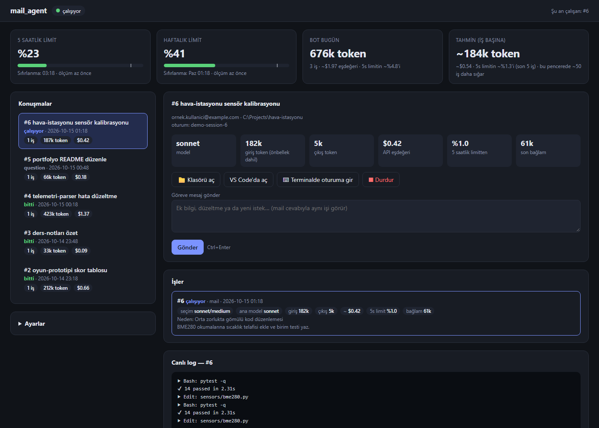
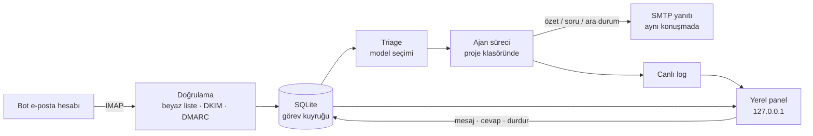

# 📬 mail-agent: E-postayla Yönetilen Kodlama Ajanı

**Bir e-postayı kodlama görevine çeviren, görevi yerel bilgisayarda bir yapay zekâ kodlama ajanına yaptıran, sonucu aynı mail konuşmasına yanıtlayan ve her şeyi bir kontrol panelinden izleten Windows servisi**

Kontrol paneli (görseldeki görevler ve adresler örnek verilerdir).

## Proje hakkında
Bilgisayarımın başında değilken de telefondan bir mail atarak yazılım işi yaptırabilmek için geliştirdim.

İzin verilen bir adresten bot hesabına gelen her mail bir **görev** olur:
1. Görev SQLite kuyruğuna girer.
2. Proje klasöründe bir kodlama ajanı (Claude Code CLI) başlatılır.
3. İş bitince özet aynı mail konuşmasına yanıt olarak gider.

Maile cevap yazarak aynı oturumla sohbete devam edilebilir. Ajan takılırsa mail ile soru sorar.

## Özellikler
- **Güvenlik**
  - Gönderen beyaz listesi uygulanır.
  - Gelen mailin **DKIM/DMARC** sonuçları `Authentication-Results` başlığından doğrulanır, böylece sahte gönderen kabul edilmez.
  - İsteğe bağlı gizli konu etiketi kullanılabilir.
  - Panel yalnızca localhost'a açıktır; Host başlığı kontrol edilir ve isteklerde CSRF jetonu zorunludur.
- **Kuyruk ve dayanıklılık**
  - SQLite tabanlı görev durum makinesi: kuyrukta, çalışıyor, soru bekliyor, bitti, hata.
  - Yeniden deneme, zaman aşımı ve yarıda kalan işi kaldığı yerden sürdürme desteklenir.
- **Konuşma takibi**
  - `In-Reply-To` ve `References` başlıklarıyla yanıtlar doğru göreve bağlanır.
  - Alıntılanan eski metin (Gmail'in TR ve EN biçimleri) ayıklanır.
- **Otomatik model seçimi:** Her görevden önce küçük ve ucuz bir modelle (yaklaşık 0,01 $) görevin zorluğu sınıflandırılır. Görev buna göre hafif, orta ya da güçlü modele yönlendirilir.
- **Kota koruması**
  - 5 saatlik ve haftalık kullanım limitlerinin doluluğu izlenir.
  - Eşik aşılınca yeni iş başlatılmaz.
  - Her iş için token, maliyet ve limit payı raporlanır.
- **Kontrol paneli**
  - Konuşmalar, canlı log, soru cevaplama ve göreve mesaj gönderme.
  - "VS Code'da aç" ve "terminalde oturuma gir" düğmeleri.
- **Servis olarak çalışma:** Windows Görev Zamanlayıcı ile oturum açılışında gizli başlar, çökerse kendini yeniden başlatır.
- **Bağımlılıksız çekirdek:** Yalnızca Python standart kütüphanesi kullanılır.
- **Testler:** 27 pytest testi. Model süreci sahte bir CLI ile taklit edilir.

## Mimari

## Kod örnekleri
- [`auth.py`](showcase/mail_agent/auth.py): gönderen doğrulama (beyaz liste, DKIM, DMARC).
- [`store.py`](showcase/mail_agent/store.py): SQLite görev durum makinesi ve şema göçleri.
- [`triage.py`](showcase/mail_agent/triage.py): şemaya bağlı JSON çıktılı zorluk sınıflandırması.
- [`runner.py`](showcase/mail_agent/runner.py): ajan sürecini başlatma, olay akışı ve kullanım istatistikleri.

## Neler öğrendim
- E-posta kimlik doğrulamasının (SPF, DKIM, DMARC) pratikte nasıl kullanılacağı.
- Uzun süren, kesintiye uğrayabilen işler için dayanıklı bir kuyruk tasarlamak.
- Yerel bir web paneline CSRF ve Host kontrolüyle temel güvenlik eklemek.

---
© Ahmet Emin Arslanbaş — Tüm hakları saklıdır. Kod inceleme amaçlı paylaşılmıştır.
